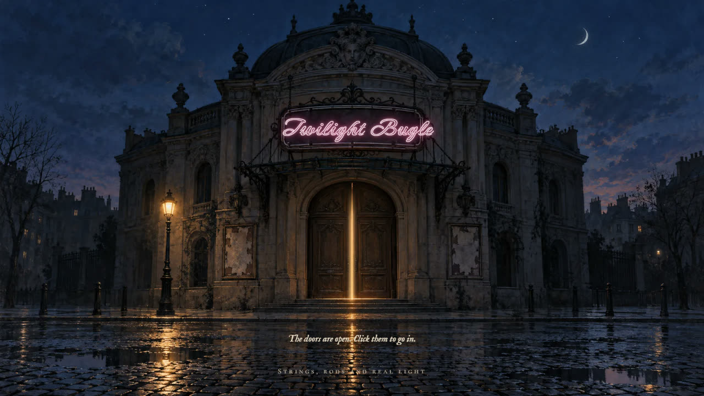
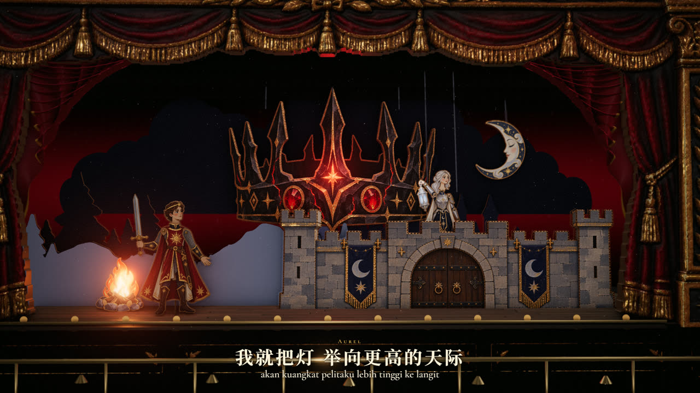
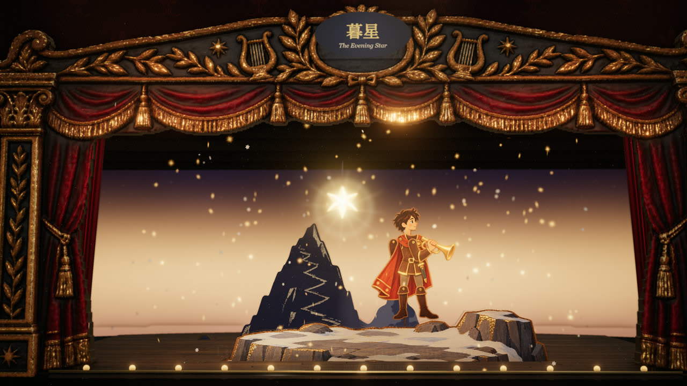
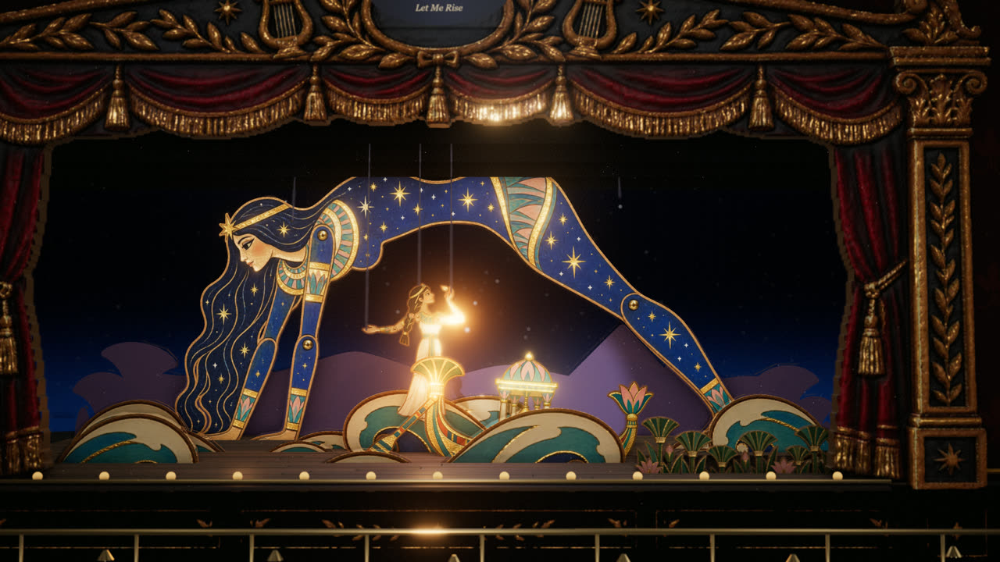
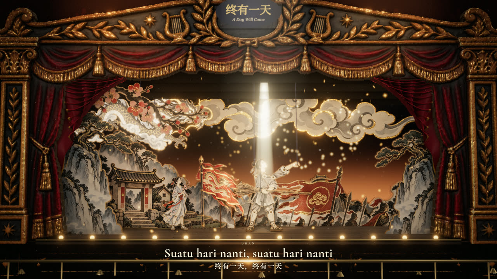
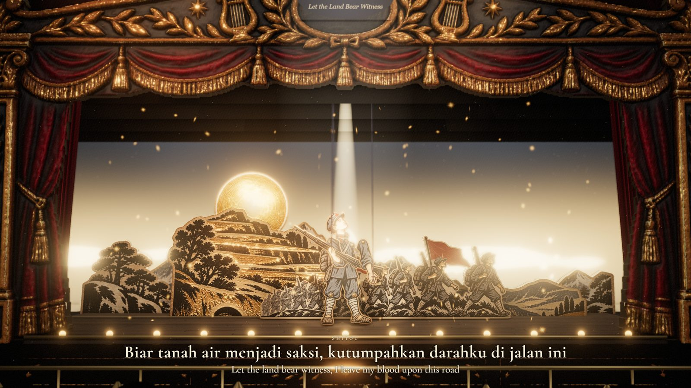
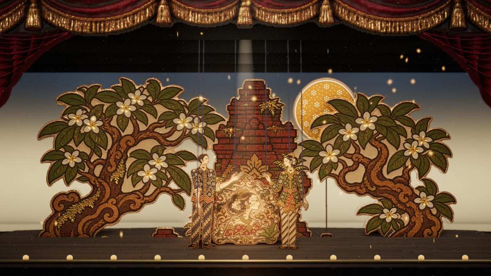
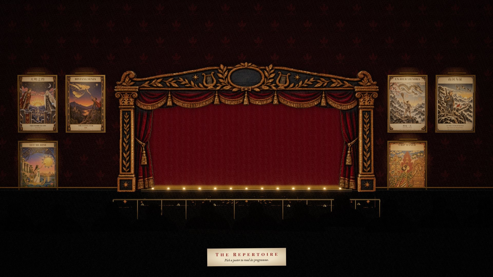

# The Twilight Bugle

The Twilight Bugle is a cardboard puppet theatre of songs. Each song is a show on one stage. Cut-card puppets play it on strings, rods and slide wires under real light. When the audience picks another show, the crew changes the set in view.

**Visit the theatre: https://twilightbugle.asfarlab.fun**



The theatre runs in the browser with Three.js. The same engine renders each show to video, frame by frame.

## The repertoire

| | Show | Sung in | Story | Style |
|---|---|---|---|---|
| I | [天明之约 · The Daybreak Vow · Janji Fajar](productions/daybreak-vow) | Mandarin, a duet | A war keeps a prince and a princess apart until daybreak. | Medieval fantasy in gouache and gold leaf |
| II | [Bintang Senja · 暮星 · The Evening Star](productions/bintang-senja) | Indonesian | A star falls at twilight. A young bugler carries her back to the sky. | Frontier fantasy at dusk, with a solo trumpet |
| III | [Let Me Rise · Biar Aku Terbit · 如日初升](productions/let-me-rise) | English | A young scribe paints the heroes of a temple wall. She wants a story of her own. | Art Nouveau with Egyptian Revival motifs |
| IV | [Un jour viendra · 终有一天 · Suatu Hari Nanti](productions/un-jour-viendra) | French | A village boy joins the imperial army as its lowest servant. His spirit never goes out. | A solemn Chinese ink painting |
| V | [山河为证 · Let the Land Bear Witness · Biar Tanah Air Menjadi Saksi](productions/shanhe-wei-zheng) | Mandarin | A boy of sixteen walks the Long March of 1934 to 1935. He loses his comrades on the road. | A Chinese woodcut print of the 1930s |
| VI | [Urip Maneh · 再世相逢 · Alive Again](productions/urip-maneh) | Javanese | Two souls miss each other across four lives in Java. In the last life, she finds her own face on an old temple wall. | A Javanese wayang beber scroll |

Each show has surtitles in two languages. If English is not one of them, a button on the programme adds it. Each show also has its own link, such as https://twilightbugle.asfarlab.fun/show/daybreak-vow.

| | |
|---|---|
|  |  |
|  |  |
|  |  |

## Inside the theatre



- **The door.** The site opens on the theatre at night. Its neon sign lights one letter at a time while the house loads.
- **The house wall.** One poster hangs for each show. A poster opens the programme of its show. The seal on the programme raises the curtain.
- **The changeover.** If another show is on stage, the curtain flies up. The crew strikes the old set in view. The cyclorama goes white. Then the new set comes in.
- **Puppetry.** Marionettes hang on strings tied to their heads and hands. Rod puppets rise through traps. Scenery slides in on tin wires from the wings. Rows of cut-card waves rock like an old wave machine.
- **Light.** A cyclorama makes the sky. A rig of spotlights throws visible beams through haze. Ambient occlusion, depth of field and bloom finish each frame.
- **Phones.** The theatre works on a phone, upright and on its side.

## How a show is made

Each show lives in `productions/<id>/`.

1. **Story.** `story/bible.md` holds the premise, the cast and the story by song section.
2. **Song.** `song/lyrics.json` holds the sung lines and their translations. Lyria sings the takes. A transcriber and a listening model check each take. `tools/master.py` locks the chosen take as `song/master.mp3` and `song/master.json`: line times, sections, beats and vocal loudness.
3. **Art.** `art/bible.md` locks one style text. An image model paints the key art, then every piece with the key art as its reference. `tools/cutout.py` cuts each piece into a cardboard solid with a relief map.
4. **Cue sheet.** `production.ts` names the pieces and their rigs, and writes the cue sheet. A cue sheet is TypeScript on a timeline, keyed to the line times and the beats of the master.
5. **Render.** Look-test stills come first, then the full video.

## Run the theatre

You need [Bun](https://bun.sh) (or Node.js 20 or later) and Chrome.

```bash
cd theatre
bun install
bun run dev
```

Open http://localhost:5199. The dev server has no gate. The door opens at once.

Render stills or a video of one show:

```bash
node tools/render.mjs --p let-me-rise --stills 30,60,90
```

```bash
node tools/render.mjs --p let-me-rise --video
```

The renderer steps headless Chrome frame by frame and pipes the frames to FFmpeg. It writes to `productions/<id>/render/`.

`theatre/README.md` lists every command and control, the rigs and the Blender build of the house.

## Make a show

The song and art tools need Python 3.11 or later, FFmpeg and the packages in `tools/requirements.txt`:

```bash
pip install -r tools/requirements.txt
```

| Variable | Service | Used by |
|---|---|---|
| `GEMINI_API_KEY` | Google Lyria for songs. Gemini for listening checks. | `lyria_song.py`, `listen.py`, `who.py`, `ask.py` |
| `ELEVENLABS_API_KEY` | ElevenLabs Scribe for transcripts with word times | `listen.py` |
| `OPENAI_API_KEY` | An OpenAI audio model for singer checks | `who.py` |
| `IMAGE_GEN` | The path of an image generation CLI | `productions/<id>/art/gen_art.sh` |

Keep keys in the environment. Do not write a key into a file in this repository.

The `IMAGE_GEN` CLI takes a `generate` and an `edit` command. Both take `--prompt-file`, `--size`, `--quality`, `--background`, `--output-format`, `--no-augment` and `--out`. `edit` also takes `--image`, the style reference.

| Tool | Job |
|---|---|
| `tools/song_prompt.py` | Builds the Lyria prompt and the line sheet of a song |
| `tools/lyria_song.py` | Generates one sung take with Lyria |
| `tools/listen.py` | Transcribes a take with Scribe. Gemini then checks the voice on each line. |
| `tools/voices.py`, `tools/who.py`, `tools/vote.py` | Decide the singer of each line in a duet, by pitch and by listening models |
| `tools/ask.py` | Asks Gemini one question about a stretch of audio |
| `tools/scrub.py` | Removes short unwanted vocal sounds and keeps the band |
| `tools/review_page.py` | Builds a listening page for the takes of a song |
| `tools/master.py` | Locks a take as the master |
| `tools/cutout.py` | Turns generated art into stage pieces: textures, relief maps and outlines |
| `tools/poster_prompt.py` | Writes the poster prompt of a show and cuts the poster for the house wall |
| `theatre/tools/render.mjs` | Renders stills and videos |
| `theatre/tools/og.mjs` | Renders the share cards of the site and of each show |

## Deploy

The live site is a Cloudflare Worker. `theatre/wrangler.jsonc` holds its configuration. `theatre/worker/index.ts` serves the build and writes the share card of each show page. It also runs an optional Turnstile gate in front of the media. To deploy your own copy, change the route, the hostname and the sitekey in `theatre/wrangler.jsonc`.

## Repository layout

```
theatre/            the engine: house, curtains, rig, puppets, cue sheets, changeover, render, Worker
productions/<id>/   one folder per show: story, song, art and cue sheet
tools/              the song and art pipelines
docs/               the architecture notes and the images of this page
```

The repository leaves out raw takes, raw image generations and rendered videos. Each show keeps what the theatre plays: `song/master.mp3` and `art/cut/`.

The design notes are in [docs/architecture.md](docs/architecture.md).

## Generated content

Google Lyria sang the songs. OpenAI image models painted the art. The staging, the puppetry and the engine are code in this repository. Check each provider's terms before you reuse a song or a piece of art.

## License

The code is under the MIT License. [LICENSE](LICENSE) holds the full text.

The songs and the art are generated content. Read the section above before you reuse them.
