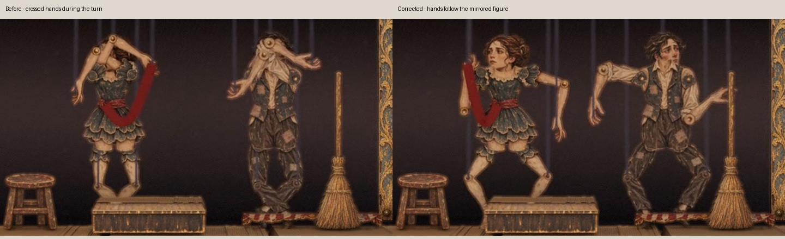
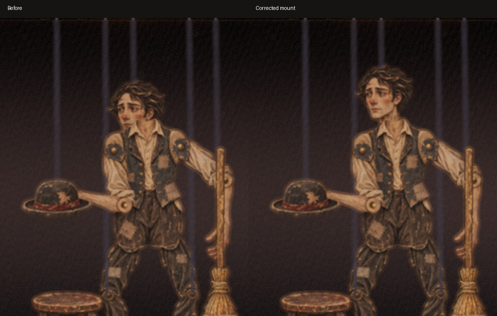

# Hand directions: review correction

16 November 2026. The producer noticed abnormal hand directions in several scenes.

## Cause

The half-turn mirrors the physical card. The original hand targets remained on their old screen sides, pulling each arm across the torso when its shoulder moved to the opposite side. At the 87-second turn the arms folded across both faces. The feet had the same space mismatch. Reaching a target accurately did not establish that the target belonged on that side of the character.

The left/right anatomy in the painted sheets is consistent. No new artwork is needed. A few outside-arm poses also used high targets too close to the shoulders, folding the elbows across the chest. Holding the broom near its top forced another unnecessarily high grip.

## Correction

- All four contacts turn with the card, using the actual depth of each painted part. The solve remains on its own plane through intermediate profile views and the mirrored pose.
- The outside elbows bend outwards. Their free palms sit lower and follow the crouched body's height. The partner and sash hands retain their shared-contact constraints.
- The clown carries the hat farther from his torso, lower than before. Release coordinates follow that revised grip.
- The broom is held near the middle of its handle. At departure the dancer carries the folded sash in her left-side card and the broom in her right-side card, avoiding a reach across her chest. The trunk sits behind the carrying palm so the fingers remain visible.
- Stage regression checks now inspect anatomical hand sides in fifteen partial and completed turns, and outside-elbow positions in fourteen scene samples, in addition to the existing contact, seek, changeover and encore checks.
- On the producer's subsequent neck warning, close-ups showed the dancer's jaw crowding the neckline during the bow. Her head mount rises 0.0149 world units, with the same head dimensions. The measured chin stays 0.0113–0.0356 units above the neckline reference throughout the score, while the neck base still overlaps the painted chest.
- The producer's browser annotation then identified the clown's visibly buried jaw. The earlier female-only clearance check missed his high shirt neckline. His mount now uses source attachment `[708,125]`, raised 0.0624 world units from `[708,225]`, with the same head dimensions. His chin clears the back neckline by 0.0068–0.0306 units throughout the score; the neck base still overlaps by at least 0.0150 units. Both actors now have independent checks using landmarks measured on their own artwork. Standing, extreme head tilts and the shared bow were inspected in rendered close-ups.

The choreography, closing work and source recording remain the same production. The live preview and current master `render/neck-corrected/un-dernier-salut.mp4` include both head corrections. On the producer's request, this master was exported to `D:\un-dernier-salut-ashthepeasant.mp4` with the established floating channel watermark. The master passes complete decoding and six audio-clock checks; the channel export passes complete decoding and preserves the master's audio packets. `render/delivery.json` and `render/youtube/export.json` retain the receipts. The earlier `render/un-dernier-salut-hands-corrected.mp4` predates the male correction; its receipt is retained as `render/hand-review/before-male-delivery.json`.
